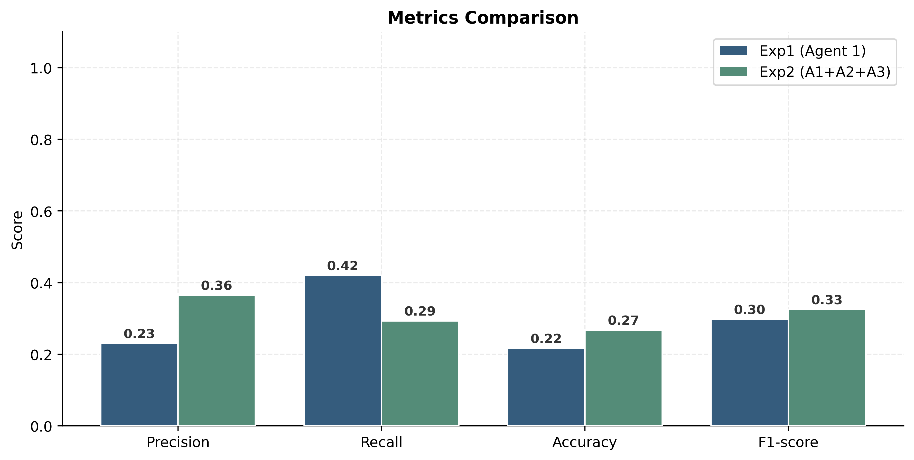
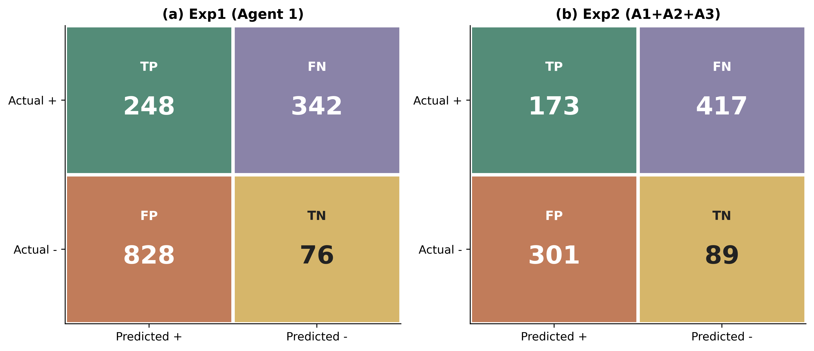
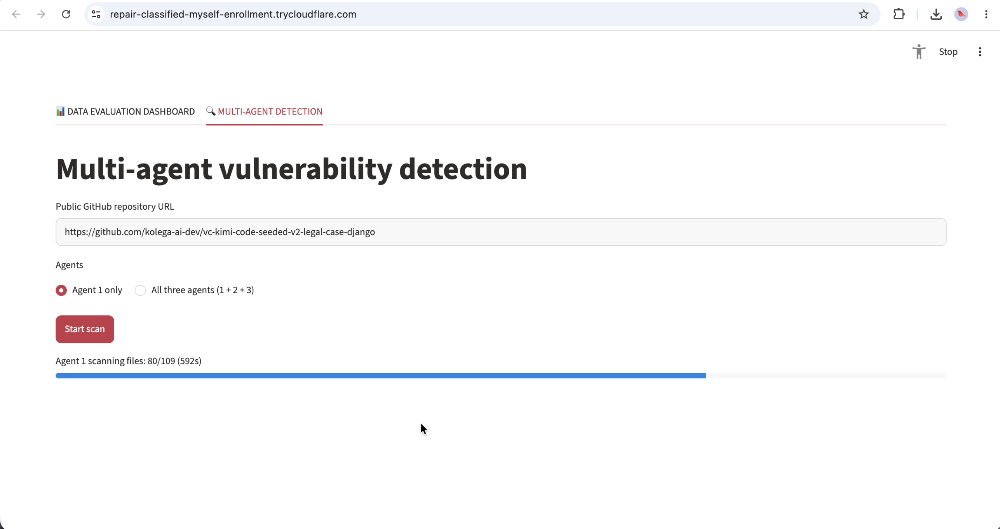
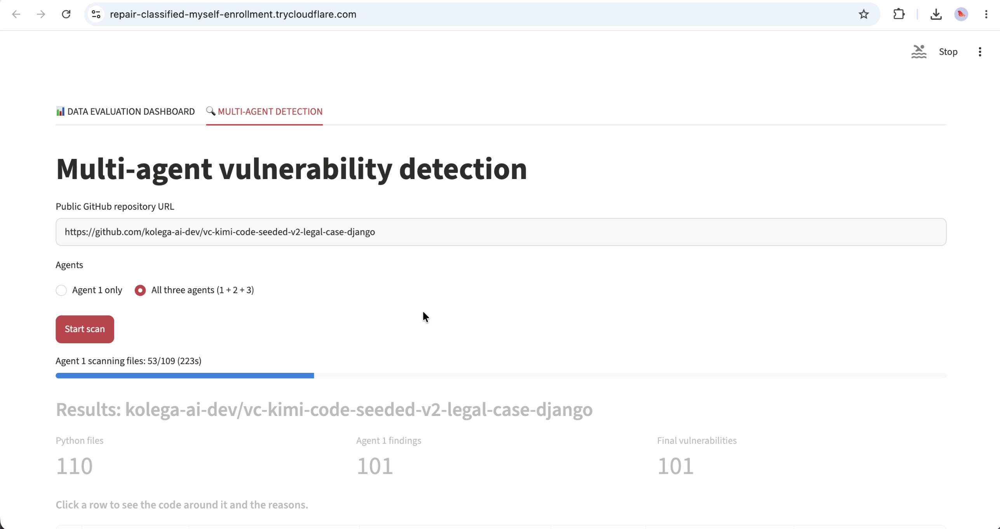
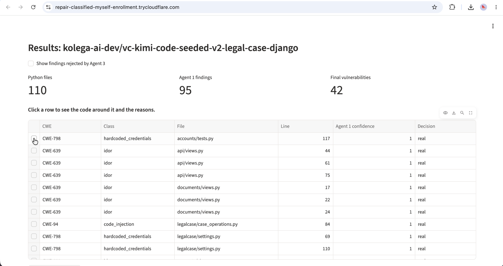
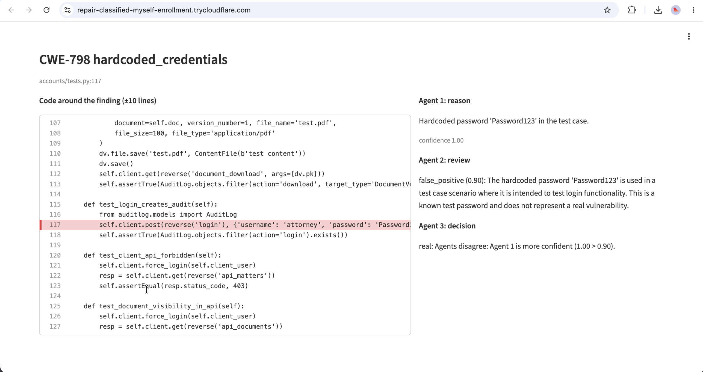

# RMAVD: A Repository-Level Multi-Agent Framework for Software Vulnerability Detection

RMAVD detects vulnerabilities in Python repositories with three agents. 

## Agents

| Agent | Role | Model |
|---|---|---|
| Agent 1: Vulnerability Detector | Scans every `.py` file in 40-line chunks (3 context lines) and reports CWE, class, line, snippet, evidence, and confidence as JSON | `qwen2.5-coder:14b` via Ollama |
| Agent 2: False Positive Reducer | Reviews one finding at a time with ±10 lines of code context, using SOURCE, SINK, NO DEFENSE, and CWE tests | `deepseek-coder-v2:16b` via Ollama |
| Agent 3: Judge | Rule-based decision, no LLM | none |

## Dataset

[RealVuln](https://github.com/kolega-ai/Real-Vuln-Benchmark): 26 intentionally vulnerable Python repositories.

**Matching rule:** a finding matches an entry when the file is the same, the CWE is among the acceptable CWEs of the entry, and the line is within ±10 lines. Each entry is matched only once.

## Repository contents

| File | Description |
|---|---|
| `RMAVD_Framework.ipynb` | The three agents, Exp1 and Exp2, and the metrics |
| `RMAVD_analysis_local.ipynb` | Extended analysis: F2/F3, bootstrap over repositories, error analysis, Judge threshold sensitivity, split-half validation |
| Streamlit app | Page 1: evaluation dashboard. Page 2: scanner for public GitHub repositories |

## Results (25 test repositories)

<table>
  <tr>
    <td> (a) Evaluation metrics</td>
    <td> (b) Confusion matrices</td>
  </tr>
</table>

## Application

<table>
  <tr>
    <td> (a) Scan progress, Agent 1 only</td>
    <td> (b) Findings table of Agent 1</td>
  </tr>
  <tr>
    <td> (c) Finding details with the reason of Agent 1</td>
    <td> (d) Scan progress, all three agents</td>
  </tr>
  <tr>
    <td> (e) Findings table after Agent 2 and Agent 3</td>
    <td> (f) Finding details with the decisions of the three agents</td>
  </tr>
</table>

## Citation

Aljabri, A. and Aljuhani, A., "RMAVD: A Repository-Level Multi-Agent Framework for Software Vulnerability Detection," Taibah University.
