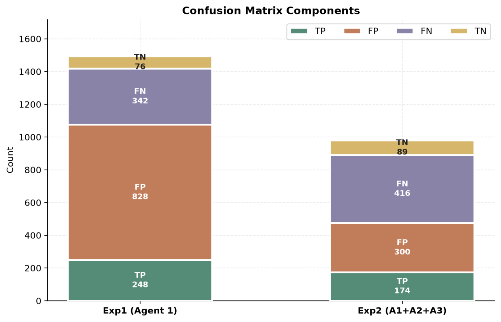
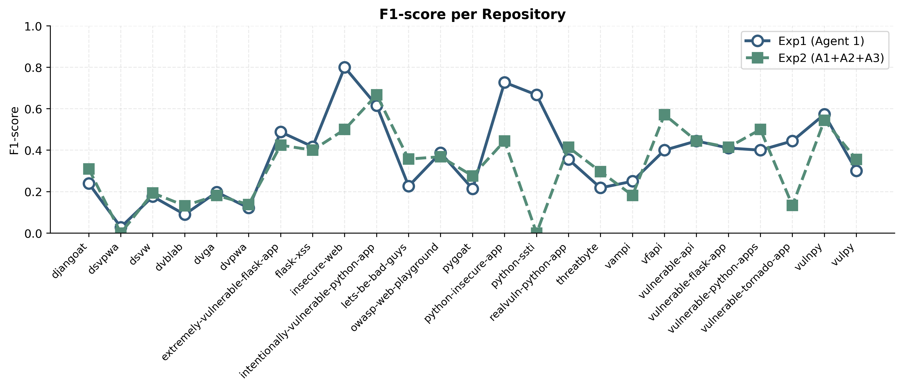
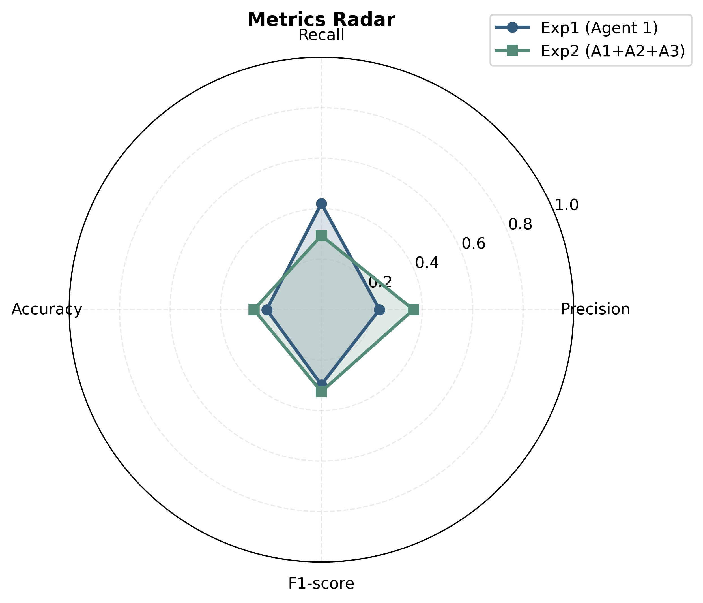
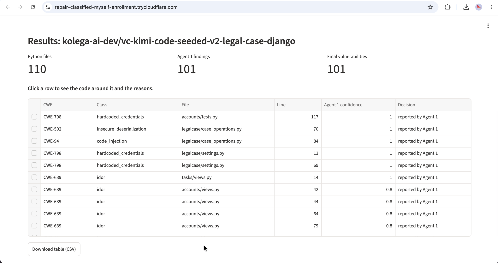
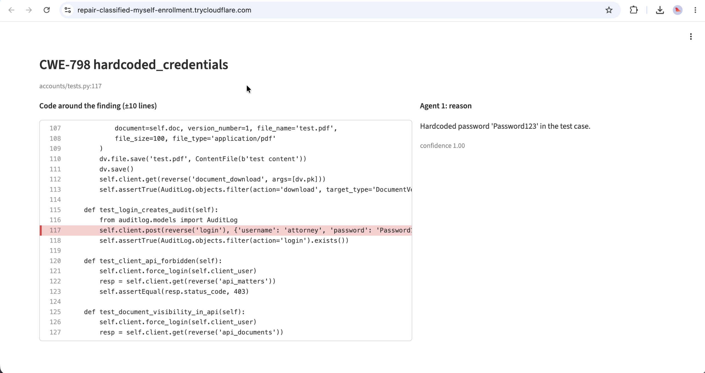

# RMAVD: A Repository-Level Multi-Agent Framework for Software Vulnerability Detection

RMAVD detects vulnerabilities in Python repositories with three agents.

## Agents

| Agent | Role | Model |
|---|---|---|
| Agent 1: Vulnerability Detector | Scans every `.py` file in 40-line chunks (3 context lines) and reports CWE, class, line, snippet, evidence, and confidence as JSON | `qwen2.5-coder:14b` via Ollama |
| Agent 2: False Positive Reducer | Reviews one finding at a time with ±10 lines of code context, using SOURCE, SINK, NO DEFENSE, and CWE tests | `deepseek-coder-v2:16b` via Ollama |
| Agent 3: Judge | Rule-based decision, no LLM | none |

## Dataset
**RealVuln** 26 intentionally vulnerable Python repositories.
[Github](https://github.com/kolega-ai/Real-Vuln-Benchmark) | [Huggingface](https://huggingface.co/datasets/Kolega-Dev/RealVuln)

**Matching rule:** a finding matches an entry when the file is the same, the CWE is among the acceptable CWEs of the entry, and the line is within ±10 lines. Each entry is matched only once.

## Repository contents

| File or folder | Description |
|---|---|
| `RMAVD.ipynb` | The three agents, Exp1 and Exp2, and the metrics |
| `RMAVD_analysis.ipynb` | Extended analysis: F2/F3, bootstrap over repositories, error analysis, Judge threshold sensitivity, split-half validation |
| `core.py` | Functions used by the Streamlit application (agents, matching rule, and metrics) |
| `app.py` | Streamlit application. Page 1: evaluation dashboard. Page 2: scanner for public GitHub repositories |
| `results/` | Saved results of the experiments |
| `figs/` | Figures and application screenshots |

## Results (25 test repositories)

<table>
  <tr>
    <td><br><sub>(a) Metrics</sub></td>
    <td><br><sub>(b) Confusion matrices</sub></td>
  </tr>
  <tr>
    <td><br><sub>(c) Confusion matrix components</sub></td>
    <td><br><sub>(d) F1-score per repository</sub></td>
  </tr>
  <tr>
    <td colspan="2" align="center"><br><sub>(e) Radar chart</sub></td>
  </tr>
</table>

**Fig. 4.** Exp1 versus Exp2: (a) metrics, (b) confusion matrices, (c) confusion matrix components, (d) F1-score per repository, and (e) radar chart.

## Application

<table>
  <tr>
    <td><br><sub>(a) Agent 1 only: scan progress</sub></td>
    <td><br><sub>(b) Agent 1 only: findings table</sub></td>
  </tr>
  <tr>
    <td><br><sub>(c) Agent 1 only: details of a selected finding</sub></td>
    <td><br><sub>(d) Three agents: scan progress</sub></td>
  </tr>
  <tr>
    <td><br><sub>(e) Three agents: findings table after review</sub></td>
    <td><br><sub>(f) Three agents: details of a selected finding</sub></td>
  </tr>
</table>

**Fig. 3.** Screenshots of the scanning page of the RMAVD application: Agent 1 only (a)–(c) and all three agents (d)–(f).

## Run on Google Colab

[](https://colab.research.google.com/github/AmalAljabri/RMAVD/blob/main/RMAVD.ipynb)

1. Click the badge to open `RMAVD.ipynb` in Google Colab.
2. Select a GPU: **Runtime > Change runtime type > T4 GPU**.
3. Run the cells in order. Run Experiment 1, then Experiment 2, and re-run each cell until it shows `25/25 repos done`.

## View the saved results (no re-run)

The `results/` folder already contains `exp1_results.json` and `exp2_results.json`.

- **App:** run `streamlit run app.py` and open **Data evaluation dashboard**.
- **Notebook:** run Part 1 to Part 3, skip Experiment 1 and Experiment 2, then run Part 5. On Colab, upload the two files to `/content/results/` first.

## Run locally (VS Code)

```bash
git clone https://github.com/AmalAljabri/RMAVD.git && cd RMAVD
pip install streamlit pandas numpy matplotlib requests ollama datasets gitpython jupyter ipykernel
ollama serve   # skip if the Ollama app is already running (use a separate terminal)
ollama pull qwen2.5-coder:14b
ollama pull deepseek-coder-v2:16b
streamlit run app.py
```

## Citation

Aljabri, A. and Aljuhani, A., "RMAVD: A Repository-Level Multi-Agent Framework for Software Vulnerability Detection," Taibah University.
